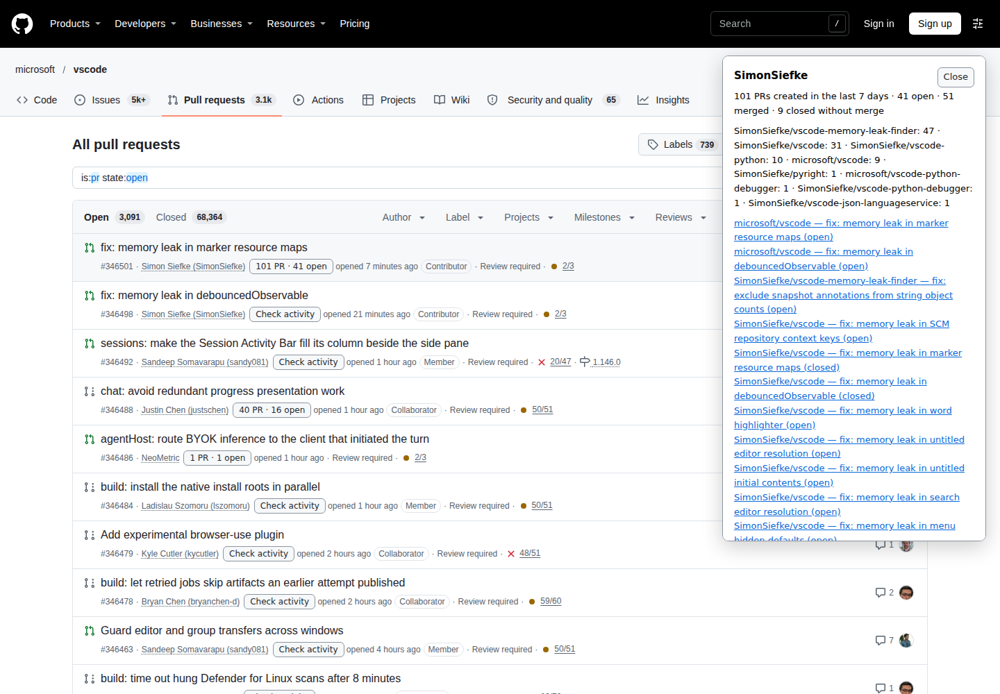
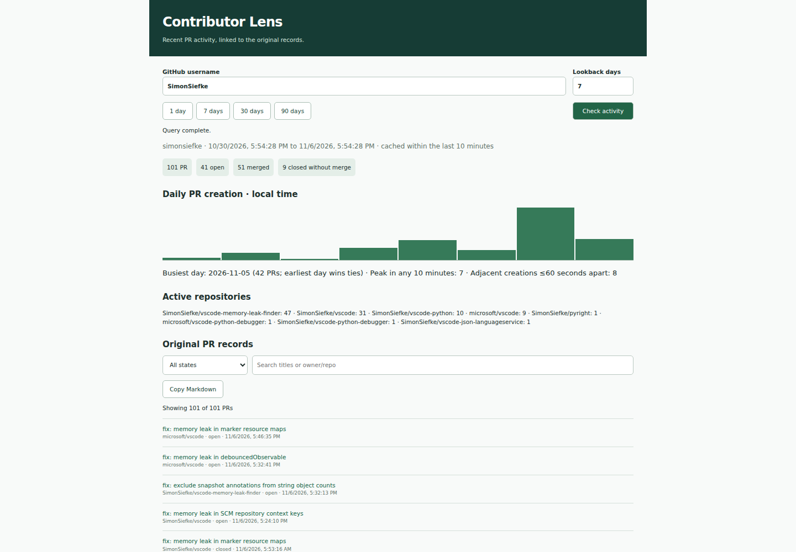
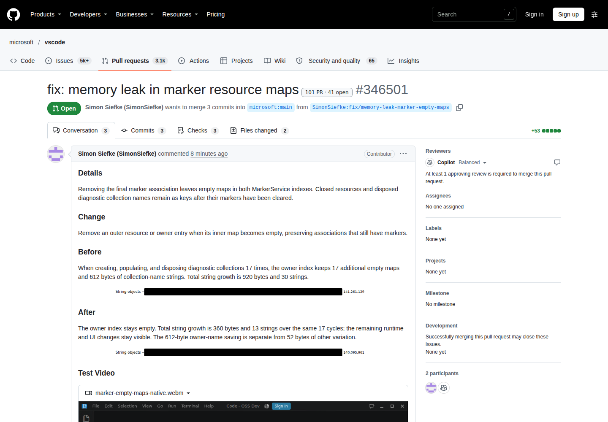

# Contributor Lens

A Manifest V3 Chrome extension for inspecting an author's recent pull requests across GitHub repositories. Every record links to the original PR. No contributor scores, identity labels, backend, or telemetry.

## Screenshots

Captured from the English extension on public GitHub pages with live API responses. Counts reflect the capture time.

### Activity in the PR list



### Full activity report



### PR detail entry



## Install

Download the ZIP from a [CI run](https://github.com/wangzhigang1999/contributor-lens/actions) or a [tagged release](https://github.com/wangzhigang1999/contributor-lens/releases), then:

1. Extract the ZIP into a folder.
2. Open `chrome://extensions` and enable **Developer mode**.
3. Click **Load unpacked** and select the extracted folder containing `manifest.json`.

You can also clone this repository and load its root folder directly. No build or npm install is required to run the extension.

CI also provides a signed CRX3. Chrome restricts off-store CRX installation on many platforms; use the ZIP with **Load unpacked** for ordinary local installation. A CRX on GitHub does not automatically provide Chrome Web Store publication or automatic updates. See [Chrome's distribution documentation](https://developer.chrome.com/docs/extensions/how-to/distribute/host-on-linux).

## Use

- On an Issue or PR list, click **Check activity** next to an author. Nearby rows automatically show a seven-day summary. Expand the card for counts, repositories, and original PR links.
- On PR details, the entry stays near the author across Conversation, Commits, and Files changed. PR identity comes from the PR header and its REST record, never from timeline commenters or reviewers.
- Open the toolbar popup to enter a username or prefill it from the current GitHub profile or PR. Choose 1, 7, 30, or 90 days, or enter any whole number from 1 to 365.
- Filter the full report by PR state, search titles or `owner/repo`, and copy the report as Markdown.
- Anonymous mode works immediately. Save an optional GitHub token in **Local token settings**. The token stays in local extension storage, is never displayed again, and is sent only to `api.github.com`.
- **Request log** and **Copy log** provide the last 100 actual API requests, including each page independently. Logs survive browser restarts and omit usernames, repository names, URLs, credentials, raw headers, and response bodies.

## Statistics and limits

The extension queries `author:<username> is:pr created:>=<UTC cutoff date>` through the REST Search API, newest first, with 100 results per page and at most 10 pages. Results are then filtered to the exact closed timestamp interval `[now − days × 24 hours, now]`.

Only PRs **created** within that interval count. State is measured at query time: open, merged, or closed without merge. The two closed outcomes use `pull_request.merged_at`. Visibility depends on the anonymous session or token's repository permissions. Cached states reflect the original query time.

The report includes local-calendar daily creation counts, including zero days; the busiest day; the highest count in any sliding 10-minute window; adjacent PR creations at most 60 seconds apart; and repository counts. The interval can touch more calendar dates than its day count. Adjacent creations are PR timestamps, not Git commits.

GitHub's `incomplete_results` flag or a search total of at least 1,000 produces an explicit incomplete-results notice. A failed page identifies its page number and error category; preceding pages are never presented or cached as a complete report. Searchable accounts with zero activity are distinct from unsearchable accounts. A plain 403 without rate-limit evidence remains an HTTP error. Requests time out after 30 seconds and are not retried automatically. GitHub's search indexing delay is outside the extension's control.

Automatic queries are limited to the viewport and 200 pixels around it: at most four different authors per anonymous list URL or 24 with a token. Manual queries remain available beyond that budget. Both automatic queries and all background API requests have a concurrency limit of two.

Concurrent queries for the same author, range, and credential generation share one request. Local storage retains 12 compact reports for ten minutes. Changing the token clears old results and prevents old in-flight queries from writing into the new cache. Request-log writes are serialized.

## Development

Use Node.js 22 or later:

```sh
npm ci
npx playwright install chromium
npm run format:check
npm test
npm run test:browser
npm run build
npm run test:package
```

`npm run format` formats JavaScript, JSON, HTML, CSS, Markdown, and workflow YAML with the committed Prettier configuration. `CHROMIUM_PATH` can override Playwright's Chromium executable for tests and packaging. Browser fixtures mock GitHub responses and do not need a token or live GitHub access. Runtime resources are bundled locally; development dependencies are not shipped.

For optional live checks, run `npm run test:live` or `npm run test:toolbar`. The latter opens the actual toolbar popup via `chrome.action.openPopup()` and operates it using CDP in headless Chromium. Set `CONTEXT_URL=https://github.com/lszomoru` to check profile prefilling. See [VALIDATION.md](VALIDATION.md) for evidence and limitations.

## CI, signing, and releases

The [CI workflow](.github/workflows/ci.yml) checks formatting, runs unit tests and mocked browser tests, then builds and verifies packages for pushes to `main`, version tags, and manual runs. Pull requests run checks without access to the signing key. Each successful build uploads:

- `contributor-lens-<version>.crx`: Chromium-generated, signed CRX3.
- `contributor-lens-<version>.zip`: runtime files ready for **Load unpacked** after extraction.
- `SHA256SUMS`: checksums for both packages.

The repository's `CRX_PRIVATE_KEY` Actions secret supplies the stable RSA signing key, keeping the packaged extension ID consistent between builds. It is not committed or uploaded. Keep a private backup if you manage this repository. Local builds without that environment variable generate a temporary key and therefore a different extension ID; forks must configure their own secret for stable IDs. Key rotation changes the extension ID.

To publish a release, update `manifest.json` and the npm package version, commit, then push a matching version tag:

```sh
# After updating both versions to 1.0.1 and committing the changes:
git tag -a v1.0.1 -m "Contributor Lens v1.0.1"
git push origin v1.0.1
```

Pushing the tag runs checks, builds the signed CRX and ZIP, verifies them, and creates a GitHub Release with all three assets. No manual upload is needed. CI rejects tags that do not match the manifest or lack the signing secret. Rerunning a tag workflow updates the existing release assets safely. Chromium is installed once and reused for tests and packaging. Live GitHub checks are deliberately excluded from CI to avoid external rate limits and changing public data.

API reference: [GitHub REST Search](https://docs.github.com/en/rest/search/search#search-issues-and-pull-requests).

To refresh the README screenshots from live GitHub pages, run `npm run screenshots`. Capture metadata is saved in `docs/screenshots/capture.json`.
